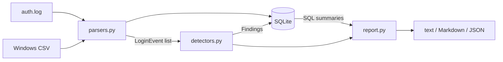

# Login Sentinel

[](https://github.com/BitByBit-05/login-sentinel/actions/workflows/tests.yml)


A command-line tool that reads **Linux SSH logs** and **Windows Security event logs**, detects login attacks, and maps each finding to **MITRE ATT&CK**.

It answers the questions a security analyst asks first when reviewing login activity: *Is someone guessing passwords? Is one machine trying every account? Did any of those guesses work?*

```
$ login-sentinel sample_data/auth.log sample_data/windows_security.csv --year 2026

LOGIN SENTINEL REPORT
============================================================
Events analysed : 114 (76 failed, 38 succeeded)
Time range      : 2026-10-12T02:05:00  to  2026-10-13T23:05:30
Unique IPs      : 14    Unique accounts: 23
Lines skipped   : 120 (not login attempts)

Findings: CRITICAL 2  HIGH 4  MEDIUM 0  LOW 0
------------------------------------------------------------
[1] CRITICAL | success_after_failures | MITRE T1078
    'bob' logged in from 192.0.2.99 after 6 failed attempts; credentials may be compromised
    Source IP: 192.0.2.99   Accounts: bob
    Seen: 2026-10-12 22:41:00 to 22:44:40

[2] CRITICAL | success_after_failures | MITRE T1078
    'svc_backup' logged in from 203.0.113.12 after 4 failed attempts; credentials may be compromised
    Source IP: 203.0.113.12   Accounts: svc_backup
    Seen: 2026-10-13 23:02:00 to 23:05:30

[3] HIGH | password_spray | MITRE T1110.003
    12 failed logins across 12 different accounts from 203.0.113.77 in 7 min 20 s
    Source IP: 203.0.113.77   Accounts: admin, alice, bob, deploy (+8 more)
    Seen: 2026-10-12 02:05:00 to 02:12:20
...
```

The full report also lists every finding and the top attacking IPs. See [a complete Markdown report](docs/sample_report.md).

## Features

- **Two log sources, one model.** Linux `auth.log` (sshd) and Windows Security events 4624/4625 are converted into the same `LoginEvent`, so every rule works on both.
- **Three detection rules** mapped to MITRE ATT&CK (details below).
- **SQLite storage.** Events and findings are written to SQLite, and the summary statistics are calculated with SQL. Use `--db` to keep the database and query it yourself.
- **Three report formats:** plain text for the terminal, Markdown for tickets and wikis, JSON for other tools.
- **Automation-friendly exit codes.** `--fail-on high` exits with code 1 when serious findings exist, so a scheduled job or pipeline can raise an alert.
- **No dependencies.** It uses only the Python standard library, and pytest only for the tests.
- **32 tests** run on Python 3.10–3.13 through GitHub Actions on every push.

## Detection rules

| Rule | Attack it catches | Logic (defaults) | MITRE ATT&CK | Severity |
|------|-------------------|------------------|--------------|----------|
| `brute_force` | Guessing one account's password over and over | ≥ 5 failures for the **same account** from the **same IP** within 10 min | [T1110.001](https://attack.mitre.org/techniques/T1110/001/) Password Guessing | HIGH |
| `password_spray` | Trying a few common passwords against many accounts, which avoids lockouts | ≥ 5 **different accounts** failing from the **same IP** within 10 min | [T1110.003](https://attack.mitre.org/techniques/T1110/003/) Password Spraying | HIGH |
| `success_after_failures` | An attacker's guess finally working | A successful login after ≥ 3 failures for the same account and IP within 10 min | [T1078](https://attack.mitre.org/techniques/T1078/) Valid Accounts | CRITICAL |

### How the detection works

All three rules use a **sliding time window**. Events are grouped (by IP and account, or by IP alone for spraying) and sorted by time. Two pointers then walk through each group: the right pointer adds the next event, and the left pointer moves forward until every event between them fits inside the window. If the window holds enough events, or enough distinct accounts for spraying, that's an attack.

Overlapping windows are merged, so a 6-minute attack with 40 attempts produces **one** finding instead of 36. Each pointer only moves forward, so a group of *n* events is checked in **O(n)** time after sorting. See `find_bursts()` in [`detectors.py`](login_sentinel/detectors.py).

### What it deliberately does *not* flag

The sample data includes normal behaviour, and the tests check that it stays quiet:

- A user who mistypes their password once or twice and then logs in (`carol`, `dave`)
- An IP making 3 slow attempts spread over two hours (`203.0.113.200`)
- Windows local logons with no network address

False positives cost analysts time, so the defaults are conservative and every threshold is configurable.

## Quick start

```bash
git clone https://github.com/BitByBit-05/login-sentinel.git
cd login-sentinel
pip install -e ".[dev]"

login-sentinel sample_data/auth.log sample_data/windows_security.csv --year 2026
pytest
```

Without installing, `python -m login_sentinel ...` works the same way.

## Usage

```bash
# Analyse a real server log. auth.log has no year, so give the year it starts in.
# Reading it usually needs sudo or membership in the "adm" group.
login-sentinel /var/log/auth.log --year 2026

# Markdown report saved to a file
login-sentinel sample_data/auth.log -f markdown -o report.md

# Stricter thresholds, keep the database, and exit 1 if anything HIGH or worse is found
login-sentinel /var/log/auth.log --window 5 --brute-threshold 3 --db events.db --fail-on high
```

| Option | Default | Meaning |
|--------|---------|---------|
| `-f`, `--format` | `text` | `text`, `markdown` or `json` |
| `-o`, `--output` | screen | Write the report to a file |
| `--db` | in memory | SQLite file to keep events and findings in |
| `--year` | current year | Year the auth.log starts in (it rolls over automatically at New Year) |
| `--window` | `10` | Detection window in minutes |
| `--brute-threshold` | `5` | Failures on one account that count as brute force |
| `--spray-threshold` | `5` | Distinct accounts from one IP that count as spraying |
| `--fail-on` | off | Exit code 1 if any finding is at or above this severity |

Exit codes: `0` finished, `1` findings at or above `--fail-on`, `2` bad input.

### Analysing Windows logs

On a Windows machine, open PowerShell **as administrator** and export the last 24 hours of logon events:

```powershell
.\scripts\export_windows_events.ps1 -Hours 24 -Path .\windows_security.csv
login-sentinel .\windows_security.csv
```

The CSV needs the columns `TimeCreated, EventID, TargetUserName, IpAddress, WorkstationName`.

### Querying the database yourself

```bash
login-sentinel sample_data/auth.log --year 2026 --db events.db

sqlite3 events.db "SELECT rule, severity, source_ip FROM findings;"
sqlite3 events.db "SELECT user, COUNT(*) AS failures FROM events WHERE success = 0 GROUP BY user ORDER BY failures DESC LIMIT 5;"
```

## Project structure

```
login_sentinel/
  models.py       LoginEvent, Finding and Severity data classes
  parsers.py      Linux auth.log (regex) and Windows CSV parsers
  detectors.py    Sliding-window detection rules
  storage.py      SQLite schema, inserts and SQL summary queries
  report.py       Text, Markdown and JSON output
  cli.py          Command-line arguments and exit codes
scripts/
  generate_samples.py        Builds the sample logs with planted attacks (fixed seed)
  export_windows_events.ps1  Exports Windows logon events to CSV
sample_data/      Sample Linux and Windows logs
tests/            pytest suite: parsers, each rule, and end-to-end CLI runs
```



## Sample data

The files in `sample_data/` are generated by `scripts/generate_samples.py` with a fixed random seed. They contain a normal working day plus planted attacks: a brute force on `root`, two password sprays, and two accounts whose passwords get guessed. Every IP address comes from the ranges reserved for documentation ([RFC 5737](https://www.rfc-editor.org/rfc/rfc5737)) or from private networks, so none belongs to a real host.

## Limitations

- An attacker who rotates through many IP addresses (a botnet) can spread attempts thin enough to stay under the per-IP thresholds.
- auth.log has no year in its timestamps, so the tool relies on `--year` and New Year rollover detection.
- It analyses log files after the fact rather than watching them live.

## Roadmap

- Rule for one account failing from **many** IPs (distributed brute force)
- Watch mode that follows a log file in real time (`tail -f` style)
- Flag logins from new countries using a GeoIP database
- Account lockout events (Windows 4740)

## License

[MIT](LICENSE)
